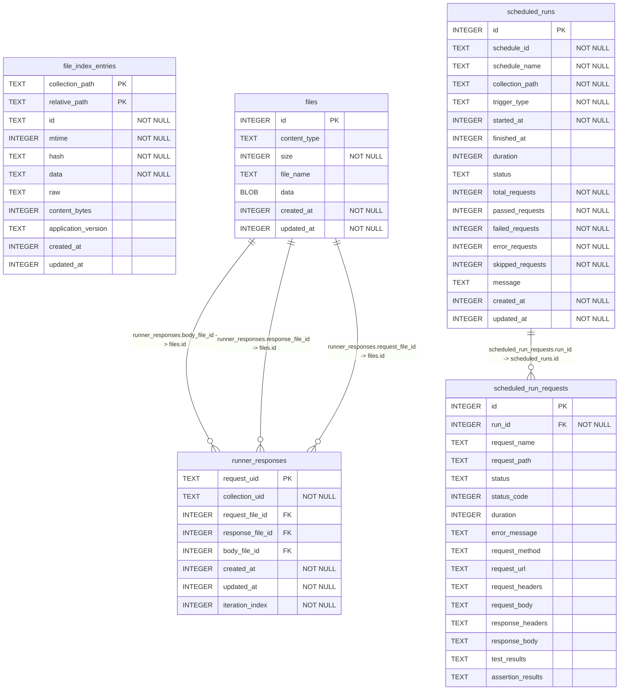

# @usebruno/sqlite schema

> Generated by `npm run schema` from `migrations/` — do not edit by hand.

Migrations applied: `0000001_runner_responses`, `0000002_file_index_entries`, `0000003_files`, `0000004_runner_response_files`, `0000005_runner_response_iteration_index`, `0000006_scheduled_runs`

## `file_index_entries`

`WITHOUT ROWID`

| Column | Type | Not null | Default | Key |
|---|---|---|---|---|
| `collection_path` | TEXT | yes |  | PK (1) |
| `relative_path` | TEXT | yes |  | PK (2) |
| `id` | TEXT | yes |  |  |
| `mtime` | INTEGER | yes |  |  |
| `hash` | TEXT | yes |  |  |
| `data` | TEXT | yes |  |  |
| `raw` | TEXT |  |  |  |
| `content_bytes` | INTEGER |  |  |  |
| `application_version` | TEXT |  |  |  |
| `created_at` | INTEGER |  |  |  |
| `updated_at` | INTEGER |  |  |  |

**Indexes**

- `idx_file_index_lookup` on (`collection_path`, `relative_path`)

## `files`

| Column | Type | Not null | Default | Key |
|---|---|---|---|---|
| `id` | INTEGER |  |  | PK |
| `content_type` | TEXT |  |  |  |
| `size` | INTEGER | yes | `0` |  |
| `file_name` | TEXT |  |  |  |
| `data` | BLOB |  |  |  |
| `created_at` | INTEGER | yes | `unixepoch()` |  |
| `updated_at` | INTEGER | yes | `unixepoch()` |  |

## `runner_responses`

| Column | Type | Not null | Default | Key |
|---|---|---|---|---|
| `request_uid` | TEXT |  |  | PK |
| `collection_uid` | TEXT | yes |  |  |
| `request_file_id` | INTEGER |  |  |  |
| `response_file_id` | INTEGER |  |  |  |
| `body_file_id` | INTEGER |  |  |  |
| `created_at` | INTEGER | yes | `unixepoch()` |  |
| `updated_at` | INTEGER | yes | `unixepoch()` |  |
| `iteration_index` | INTEGER | yes | `0` |  |

**Foreign keys**

- `body_file_id` → `files.id`
- `response_file_id` → `files.id`
- `request_file_id` → `files.id`

## `scheduled_run_requests`

| Column | Type | Not null | Default | Key |
|---|---|---|---|---|
| `id` | INTEGER |  |  | PK |
| `run_id` | INTEGER | yes |  |  |
| `request_name` | TEXT |  |  |  |
| `request_path` | TEXT |  |  |  |
| `status` | TEXT |  |  |  |
| `status_code` | INTEGER |  |  |  |
| `duration` | INTEGER |  |  |  |
| `error_message` | TEXT |  |  |  |
| `request_method` | TEXT |  |  |  |
| `request_url` | TEXT |  |  |  |
| `request_headers` | TEXT |  |  |  |
| `request_body` | TEXT |  |  |  |
| `response_headers` | TEXT |  |  |  |
| `response_body` | TEXT |  |  |  |
| `test_results` | TEXT |  |  |  |
| `assertion_results` | TEXT |  |  |  |

**Foreign keys**

- `run_id` → `scheduled_runs.id`

**Indexes**

- `idx_scheduled_run_requests_run` on (`run_id`)

## `scheduled_runs`

| Column | Type | Not null | Default | Key |
|---|---|---|---|---|
| `id` | INTEGER |  |  | PK |
| `schedule_id` | TEXT | yes |  |  |
| `schedule_name` | TEXT | yes |  |  |
| `collection_path` | TEXT | yes |  |  |
| `trigger_type` | TEXT | yes |  |  |
| `started_at` | INTEGER | yes |  |  |
| `finished_at` | INTEGER |  |  |  |
| `duration` | INTEGER |  |  |  |
| `status` | TEXT |  |  |  |
| `total_requests` | INTEGER | yes | `0` |  |
| `passed_requests` | INTEGER | yes | `0` |  |
| `failed_requests` | INTEGER | yes | `0` |  |
| `error_requests` | INTEGER | yes | `0` |  |
| `skipped_requests` | INTEGER | yes | `0` |  |
| `message` | TEXT |  |  |  |
| `created_at` | INTEGER | yes | `unixepoch()` |  |
| `updated_at` | INTEGER | yes | `unixepoch()` |  |

**Indexes**

- `idx_scheduled_runs_schedule_started` on (`schedule_id`, `started_at`)
- `idx_scheduled_runs_status` on (`status`)
